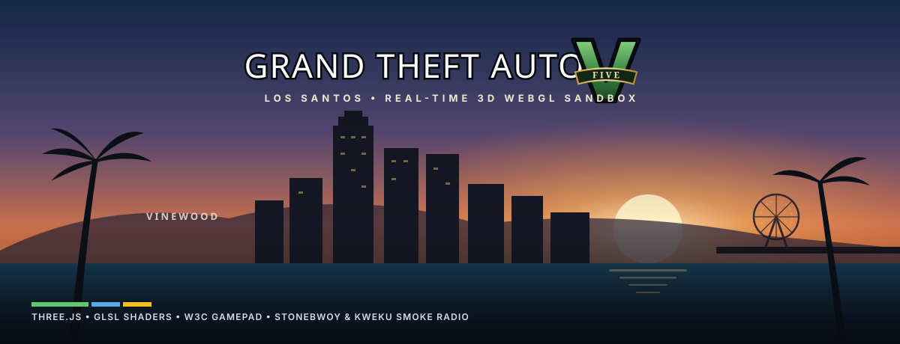

<div align="center">

# Grand Theft Auto V — Los Santos

**A zero-install, real-time 3D open-world recreation of Grand Theft Auto V in sun-drenched Los Santos, built for players and web graphics enthusiasts to explore directly in the browser.**

[](tsconfig.json)
[](#)
[](package.json)
[](https://github.com/Randy-Dosu/GTA-V_clone/pulls)

[Run & Usage Guide](USAGE.md) • [Controls & Gamepad](USAGE.md#controls-reference) • [Report Bug](https://github.com/Randy-Dosu/GTA-V_clone/issues) • [Request Feature](https://github.com/Randy-Dosu/GTA-V_clone/issues)

<br />



</div>

---

## Overview

**Grand Theft Auto V — Los Santos** brings an open-world sandbox experience—complete with downtown skyscrapers, Vinewood Hills, Vespucci Beach, three switchable protagonists, story missions, police pursuits, and dynamic radio—straight to any modern desktop browser with zero external 3D model downloads. Every texture, mesh, GLSL sky/ocean shader, vehicle reflection, and instrumental radio riddim is generated procedurally in TypeScript for instant startup, smooth 60 FPS rendering, and clean modular extensibility.

### Key Features

* **Open-World Los Santos Sandbox:** Explore Maze Bank Tower (with rooftop helipad), FIB & IAA Twin Towers, Legion Square, Rockford Hills, Vinewood Hills & the 3D `VINEWOOD` sign, Galileo Observatory, Vespucci Beach, and Del Perro Pier alongside live AI traffic and pedestrians.
* **Three Protagonists, Missions & LSPD:** Switch seamlessly between **Franklin**, **Michael**, and **Trevor** via the signature GTA V satellite sky-zoom camera with unique Special Abilities, tackle 4 multi-stage Story Missions (`F`, `S`, `L`, `M`) with street-snapped GPS routing, customize cars at **Los Santos Customs**, gear up at **Ammu-Nation**, and evade 1–5 star LSPD pursuits.
* **Real-Time PBR Graphics & Post-Processing:** Custom GLSL atmospheric sky dome and animated Pacific Ocean shaders, dynamic day/sunset/night cycle, PMREM environment reflections, automotive clearcoat materials, 2048px soft directional shadows, ACES Filmic tone mapping, and MSAA HDR bloom.
* **Full Keyboard, Mouse & W3C Gamepad Support:** Plug-and-play Xbox, PlayStation (DualSense / DualShock), and Bluetooth controller support featuring analog stick/trigger vehicle and helicopter physics, automatic Xbox/PlayStation HUD glyphs, `dual-rumble` haptics, radial wheels, and full console navigation across every menu and map.
* **Stonebwoy & Kweku Smoke Soundtrack:** Curated 9-track radio across **Gold Coast FM**, **BHIM Nation 101.9** (*People Dey*, *Run Go*, *Send Dem a Prayer*, *Hero*, *Jejereje*), and **Scatter Der 96.5** (*Sober*, *Faith*, *Survivor*, *Hallelujah*) with built-in Web Audio Reggae, Dancehall, Afro-Highlife, Gospel Trap, and GH Drill instrumentals plus one-click local MP3 streaming.

---

## Tech Stack

* **3D Engine & Shaders:** Three.js (`r170`), WebGL 2, custom GLSL sky/ocean shaders, PMREM reflections, `EffectComposer` + `UnrealBloomPass`, procedural canvas PBR textures
* **Gameplay, UI & Input:** Strict TypeScript (`5.6`), HTML5 Canvas 2D rotating radar & interactive GPS map, Pointer Lock API, W3C Gamepad API with `dual-rumble` haptics
* **Audio Engine:** Web Audio API (procedural multi-genre sequencer, dub delay, compressor, dynamic engine/drift/siren & weapon SFX) + HTML5 Audio local MP3/M4A/WAV streaming
* **Build & Dev Tooling:** Vite (`6.x`), ES Modules, zero external runtime asset dependencies
* **Containerization:** Multi-stage Docker build (`node:22-alpine` → `nginx:alpine`) with Docker Compose on port `5173`

---

## Architecture

```text
┌─────────────────────────────────────────────────────────────────────────┐
│                       GTAVGame Loop (src/main.ts)                       │
│            Fixed-Clamp dt • Time Dilation • Game Mode Router            │
└───────┬─────────────────┬──────────────────┬────────────────────┬───────┘
        │                 │                  │                    │
        ▼                 ▼                  ▼                    ▼
┌───────────────┐ ┌───────────────┐ ┌────────────────┐ ┌──────────────────┐
│ Input Layer   │ │ World & AI    │ │ Gameplay Core  │ │ Presentation     │
│ • InputMgr    │ │ • WorldData   │ │ • Player (MFT) │ │ • SkyAndOcean    │
│ • GamepadMgr  │ │ • CityBuilder │ │ • Vehicle/Heli │ │ • TextureFactory │
│ • CameraCtrl  │ │ • Traffic/Ped │ │ • MissionSys   │ │ • Effects/Bloom  │
└───────────────┘ └───────────────┘ │ • PoliceSystem │ │ • UIMgr/Minimap  │
                                    └────────────────┘ └────────┬─────────┘
                                                                │
                                                                ▼
                                                    ┌──────────────────────┐
                                                    │ Audio & Soundtrack   │
                                                    │ • AudioEngine (SFX)  │
                                                    │ • SoundtrackData     │
                                                    │ • Local MP3 Streamer │
                                                    └──────────────────────┘
```

---

## Getting Started

### Docker (Recommended — everything in one container)

```bash
git clone https://github.com/Randy-Dosu/GTA-V_clone.git
cd GTA-V_clone
docker compose up --build
```

Open `http://localhost:5173` — the multi-stage image builds the game with Node and serves the production bundle via nginx. No Node.js install required on the host.

### Local Development

```bash
npm install
npm run dev
```

For installation, dev/production commands, complete keyboard and controller mappings, gameplay guides, and custom MP3 soundtrack setup, see **[USAGE.md](USAGE.md)**.
